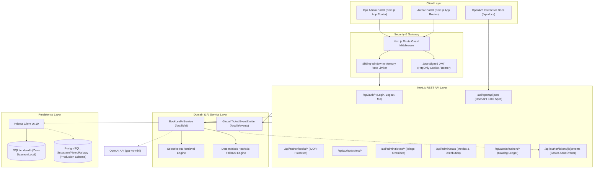

# BookLeaf Author Support & Communication Portal

A full-stack, enterprise-grade publishing operations and author support portal built for the **BookLeaf Publishing Full-Stack Developer** hiring technical assignment.

The platform provides a dual-interface architecture:
- **Author Portal**: Empowers authors to inspect their book catalog, monitor quarterly royalties based on BookLeaf's 80/20 net profit model, submit contextual support tickets, and receive real-time admin responses.
- **Operations Admin Portal**: Equips the operations and editorial desks to manage incoming author queries, leverage AI-powered auto-classification (6 categories) and priority scoring (4 tiers), generate grounded response drafts calibrated against BookLeaf's official Knowledge Base, manage private internal notes, and track team assignments.

---

## Architecture Overview



---

## Key Features

### Author-Facing Portal
- **Dashboard**: Live metrics aggregated from database records: Total Books, Published Books, In-Production Titles, Copies Sold, Total Royalty Earned (INR), Royalty Disbursed, and Royalty Pending (under ₹1,000 threshold or awaiting quarterly disbursement).
- **My Books**: Searchable, filterable catalog displaying ISBN, genre, publication date, status, MRP, copies sold, earnings, and platform channels (Amazon India, Flipkart, BookLeaf Store, Amazon US, Amazon UK).
- **Book Details**: Deep-dive book view with an interactive **9-stage production milestone tracker** (Manuscript Received → Editing → Cover Design → Typesetting → Proofreading → ISBN Assignment → Printing → Distribution Setup → Published & Live), net profit economics breakdown, and related support inquiries.
- **Submit Support Query**: Form featuring a book selector dropdown, subject line, detailed description with character limits, and attachment URL reference. Persists to the database **before** AI processing to prevent data loss.
- **My Tickets & Real-Time Stream**: Live conversation view powered by **Server-Sent Events (SSE)**. New admin replies and status changes appear in real time without refreshing.
- **Author Account & Payouts**: Verified author details, pen name, linked bank details (masked account number, IFSC code), and official quarterly payout policy guidelines.

### Admin-Facing Operations Portal
- **Operations Dashboard**: Real-time operational intelligence calculated directly from database records: Open, In Progress, Critical/High-Priority Unresolved, Resolved, category distribution, priority distribution, and recent audit activity.
- **Ticket Queue (Operations Inbox)**: Multi-criteria filtering by status, category, and priority. Search by ticket ID, subject, author, or book. Sorting by urgency (Critical first, oldest unresolved first). Pagination support.
- **Flagship Ticket Workspace**:
  - Author and related book fact sheet (bank linkage, copies sold, royalty pending, production stage).
  - AI Auto-Classification into exactly 6 categories with confidence score and rationale.
  - Human Category Override (persists and prevents AI overwriting).
  - AI Priority Scoring into 4 tiers with Human Override.
  - Ticket Assignment ("Assign to Me" / team member assignment).
  - Status updates (`OPEN`, `IN_PROGRESS`, `RESOLVED`, `CLOSED`).
  - **Strict Message Privacy**: Clear visual distinction between public replies (visible to author) and private internal notes (locked to admins, never exposed to author API or SSE).
  - **Grounded AI Response Editor**: Generates proposed replies grounded strictly in BookLeaf policies. Admins can edit before sending; drafts are **never auto-sent**.
  - Audit trail logging every action with actor provenance.
- **Authors & Catalog Registry**: Full roster of authors with total catalog titles, lifetime sales, earnings ledger, and active support tickets.
- **API Documentation**: Interactive documentation explorer at `/api-docs` and raw OpenAPI 3.0.0 specification at `/api/openapi.json`.

---

## Tech Stack & Design Decisions

| Layer | Technology | Decision Rationale |
|---|---|---|
| **Framework** | Next.js 16 (App Router) | Modern server components, typed route handlers, edge/node compatibility, fast streaming. |
| **Language** | TypeScript 5 | Strict end-to-end type safety across domain models, API contracts, and UI props. |
| **Styling** | Tailwind CSS v4 | Editorial aesthetic (warm neutrals `bg-stone-50`, slate typography, indigo accents). Zero Tailwind runtime overhead. |
| **Icons** | Lucide React | Lightweight, accessible, consistent iconography. |
| **Database & ORM** | Prisma v6 + SQLite / PostgreSQL | Zero-daemon, instant local setup with SQLite (`dev.db`). 100% production-compatible PostgreSQL schema (`prisma/schema.postgresql.prisma`) ready for Supabase/Neon. |
| **Validation** | Zod | Runtime schema validation for API request bodies and AI structured outputs. |
| **Authentication** | Jose (Signed JWTs) | High-entropy HS256 signed JWTs in `HttpOnly`, `SameSite=Lax` cookies, with Bearer token header fallback for REST clients. |
| **Real-Time** | Server-Sent Events (SSE) | Native HTTP streaming with automatic heartbeat and connection teardown. Simpler and more resilient than WebSockets for unilateral updates. |
| **AI Integration** | OpenAI API + Fallback Engine | Server-only `gpt-4o-mini` with selective Knowledge Base retrieval, prompt injection guards, and deterministic offline fallback. |
| **Testing** | Node.js Test Runner + tsx | Native zero-dependency test runner executing fast, deterministic unit and integration tests. |

---

## Demo Credentials & Seed Data

The database is pre-seeded with **10 authors**, **18 books**, and sample support inquiries directly representing the evaluation dataset and PDF scenarios:

| Role | Account Email | Password | Details |
|---|---|---|---|
| **Operations Admin** | `admin@bookleafpublishing.com` | `BookleafAdmin@2026` | Full admin privileges across ticket queue, overrides, and AI drafting. |
| **Author (Published)** | `vikram.seth@example.com` | `AuthorPass@2026` | 2 published books (*A Monsoon Twilight*, *Songs of the Yamuna*), ₹50,552 earned. |
| **Author (Pending Payout)** | `anita.nair@example.com` | `AuthorPass@2026` | Published books with ₹6,168 pending royalty payout (ticket BL-8401). |
| **Author (In Production)** | `rohan.sharma@example.com` | `AuthorPass@2026` | *Echoes of the Ghats* currently in `TYPESETTING` stage (ticket BL-8404). |
| **Author (ISBN Discrepancy)**| `priya.deshmukh@example.com` | `AuthorPass@2026` | *The Maratha Fortress* with Amazon ISBN mismatch inquiry (ticket BL-8403). |
| **Author (Print Quality)** | `rajesh.gupta@example.com` | `AuthorPass@2026` | Author copies print defect inquiry. |

*Quick-fill demo buttons are provided directly on the `/login` page for fast evaluation.*

---

## Local Installation & Setup

### Prerequisites
- Node.js v20.x or v22.x+ (tested on Node v24.17.0)
- npm v10+

### 1. Clone & Install Dependencies
```bash
git clone <repository-url> bookleaf
cd bookleaf
npm install
```

### 2. Configure Environment Variables
Create a `.env` file based on `.env.example`:
```bash
cp .env.example .env
```
Default `.env` configuration:
```env
DATABASE_URL="file:./dev.db"
SESSION_SECRET="bookleaf-secure-session-key-randomized-entropy-998877"
OPENAI_API_KEY="" # Leave empty to use intelligent deterministic heuristic fallback
OPENAI_MODEL="gpt-4o-mini"
NEXT_PUBLIC_APP_URL="http://localhost:3000"
NODE_ENV="development"
```

### 3. Initialize Database & Seed Dataset
```bash
# Push schema to SQLite
npx prisma db push

# Seed 10 authors, 18 books, and initial tickets
npm run db:seed
```

### 4. Run the Development Server
```bash
npm run dev
```
Open [http://localhost:3000](http://localhost:3000) in your browser.

### 5. Run the Production Build
```bash
npm run build
npm run start
```

---

## Automated Test Suite

Run the full automated test suite covering authentication, multi-tenant isolation, IDOR prevention, AI schema validation, and royalty math:
```bash
npm run test
```

### Test Coverage Highlights:
- **`tests/auth.test.ts`**: Password hashing verification, session signing, tampered token rejection, and role separation.
- **`tests/multi_tenant_isolation.test.ts`**: Verifies that Author A cannot access Author B's books or tickets, and proves that private internal notes are strictly filtered from author queries.
- **`tests/ai_integration.test.ts`**: Zod schema validation across all 6 categories and 4 priorities; calibrated accuracy tests against all 7 PDF sample queries; token-conscious selective KB retrieval.
- **`tests/royalties_and_dataset.test.ts`**: Verifies exact counts (10 authors, 18 books, 2 in production); BookLeaf 80/20 net profit math; sub-₹1,000 threshold rollover logic.

---

## AI Architecture & Prompt Strategy

### 1. Auto-Classification (6 Categories)
Incoming tickets are classified into exactly one of:
1. `Royalty & Payments`
2. `ISBN & Metadata Issues`
3. `Printing & Quality`
4. `Distribution & Availability`
5. `Book Status & Production Updates`
6. `General Inquiry`

### 2. Priority Scoring (4 Tiers)
Priorities are scored based on operational impact:
- **`Critical`**: ISBN retailer mismatches, duplicate identifiers, or prolonged overdue royalties causing severe disruption.
- **`High`**: Channel availability blackouts ("Currently Unavailable" on Amazon/Flipkart) or defective author copies.
- **`Medium`**: Standard royalty breakdowns or pre-publication production timeline inquiries.
- **`Low`**: Author bio or description updates.

### 3. Cost Awareness & Token Efficiency
- **Selective Section Retrieval**: Rather than blindly dumping the entire knowledge base into every prompt, `getRelevantKnowledge()` extracts only the sections matching the ticket's category and keywords.
- **Bounded History**: The conversation context is capped at the last 4 exchanges to protect context tokens.
- **Model Choice**: Configured for `gpt-4o-mini`, providing high quality structured JSON output at ~1/15th the cost of legacy models.
- **Max Output Tokens**: Strictly constrained (300 tokens for classification, 800 tokens for response drafting).

### 4. Prompt Injection & Anti-Hallucination Guardrails
- Author inputs are isolated within XML boundaries (`<untrusted_author_input>`) with explicit system instructions to treat content strictly as untrusted data.
- The model is instructed **never to invent** transaction references, delivery dates, or unauthorized reprint approvals.

### 5. Graceful Degradation
If `OPENAI_API_KEY` is not provided, expired, or rate-limited:
- Ticket submission **always succeeds** (persistence occurs prior to AI enrichment).
- The system automatically engages the deterministic fallback engine (`src/lib/ai/heuristics.ts`), producing high-accuracy category classification, priority scoring, and policy-grounded drafts.
- Admins are informed via a clear UI badge without disruptive application errors.

---

## Security Implementation

1. **Server-Side Session Validation**: Sessions are stored in signed, tamper-proof HttpOnly cookies with `SameSite=Lax` and path restrictions.
2. **Multi-Tenant Ownership & IDOR Protection**: Every query to `/api/author/*` resolves ownership against `user.id` or `authorProfile.id` at the database level.
3. **Strict Message Separation**: Private internal notes (`isInternalNote: true`) are excluded from all author queries and never emitted to the author's SSE event stream.
4. **Brute-Force Rate Limiting**: Sliding-window rate limiter protects `/api/auth/login` (5 attempts/min) and ticket creation (10 attempts/min).
5. **No Secret Leaks**: Secrets reside exclusively in server-side environment variables; passwords use salted bcrypt hashes with constant-time comparison.

---

## Production Deployment Checklist

To deploy to production (Vercel + Supabase/Neon PostgreSQL):
1. **Database**: Create a PostgreSQL database on [Supabase](https://supabase.com) or [Neon](https://neon.tech).
2. **Schema**: Point `DATABASE_URL` to your PostgreSQL connection string and run:
   ```bash
   npx prisma db push --schema=prisma/schema.postgresql.prisma
   npm run db:seed
   ```
3. **Hosting**: Import the repository into [Vercel](https://vercel.com) or [Railway](https://railway.app).
4. **Environment Variables**: Set `DATABASE_URL`, `SESSION_SECRET`, `OPENAI_API_KEY`, and `NEXT_PUBLIC_APP_URL` in the provider's dashboard.
5. **Verify**: Test login with seeded credentials and confirm real-time updates over HTTPS.
